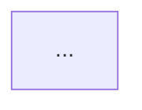

# Notion 库和图

三个库，数据源 id 如下。一天一行（板块进程是一天一线一行）。写之前先用 `notion-fetch` 看一下库的 schema，不靠这页抄字段。

| 库 | 数据源 | 一行是什么 |
| --- | --- | --- |
| 情绪读数 | `collection://41c80c68-3500-8154-a004-000b0357b3fe` | 一天 |
| 板块进程 | `collection://41c80c68-3500-8153-a09b-000b4ac9bdfe` | 一天一条线 |
| 事件库 | `collection://41c80c68-3500-81ce-8a45-000b1e55dc3e` | 一条消息 |

看盘日志仍是 `collection://22d8f6d4-6ff7-4e28-8cc1-769508d5ab7b`，正文写判断，库里写数字。

## 情绪读数

必填：日期、涨停数、跌停数、炸板数、炸板率（百分数）、最高板、最高板龙头、昨日涨停数、昨日涨停溢价中位数、创业板指涨跌幅、阶段、第几天、预警。

当日判断：早盘写下的那句。判断核对：第二天收盘后，对着实际读数填对、部分对、错。核对说明写错在哪个读数。

规则：

- 炸板率 = 炸板数 ÷（涨停数 + 炸板数）× 100。
- 昨日涨停溢价中位数：昨日整池今天收盘涨跌幅的中位数，整池算，不过滤。
- 最新一天的「次日」类字段先空着，第二天补。
- 回填的阶段、预警是推断，在来源里写明。

## 板块进程

必填：日期、线、阶段、涨停数、最高板、龙头。选填：类型（大板块、大板块候选、小杂毛）、阶段第几天、备用锚、次日溢价中位数。

线的选项不够时直接新增选项，不要放进「其他」凑数。类型只在有依据时填：大板块要同时有可核对的催化、至少 3 只、有中军在成交。回填的历史行类型留空。

次日溢价中位数：这条线当天涨停成员，第二天收盘涨跌幅的中位数。这是校准前排、跟风、中军阈值的唯一依据。

## 事件库

必填：名称、日期、类型（外围、政策、传闻、公司、产业）、核实状态。打中的线、底层逻辑、传导路径、价格先动、走到哪一步、一日结果、三日结果、判断对错在事件有结果后补。

传闻在公告对上之前，核实状态一直是未核实，来源链写首发是谁、转了几级、有没有公司或交易所澄清。

## 图

图表视图建在三个库上，创建时用 `notion-create-view`，配置串用视图 DSL。已有的：

- 情绪读数：涨停、跌停、昨日涨停溢价、最高板四张图，加一个按日期的表。
- 板块进程：各线涨停数（按线堆叠的柱状图），加一个按线分组的表。

## 关系图

用 Notion 正文里的 mermaid 代码块：

````

````

写进去之后用 `notion-fetch` 读回，确认 `mermaid` 语言标签还在。脚本输出的节点：

- 龙头节点、中军节点（虚线，标「容量」）、前排和跟风两个 `subgraph`、备用锚节点。
- 子图 id 用英文（`g_front`、`g_follow`），中文 id 会让图报错。
- 每个子图最多 12 只，超出写「另有 N 只」。

渲染只能在 Notion 应用里看。不渲染时的回退：把 mermaid 渲染成 SVG 或 HTML，用 `notion-create-attachment` 上传，附在页里。
